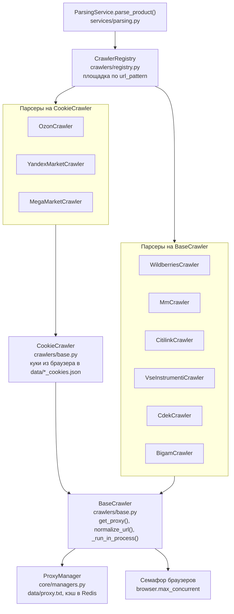
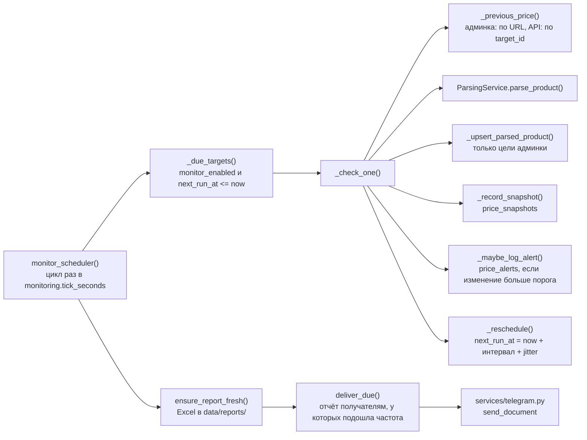

# C4, уровень 3: компоненты

Два места, устройство которых важно понимать при изменениях: парсеры и мониторинг.

## Парсеры (`crawlers/`)

- Новый парсер регистрируется сам при объявлении класса: достаточно задать `marketplace_name` и `url_pattern` (порядок описан в docstring `crawlers/base.py`).
- Каждый парсер идёт от быстрого способа к медленному: HTTP API → разбор HTML → браузер. Пример для Wildberries: [сценарий разбора](sequences.md#разбор-товара-wildberries).
- Браузерные функции выполняются в отдельном процессе, поэтому должны быть `@staticmethod` и получать всё через аргументы (ADR 0009).

## Мониторинг (`services/`)

- Изменения цены не отправляются в Telegram сразу. Они записываются в `price_alerts` (видны в панели и в `/v1/alerts`) и попадают на лист изменений в Excel-отчёте, который уходит по расписанию получателя (`alert_sources.frequency`).
- Мониторы API проходят тот же путь, но не пишут в `parsed_products` и не попадают в отчёт владельца (ADR 0003).
