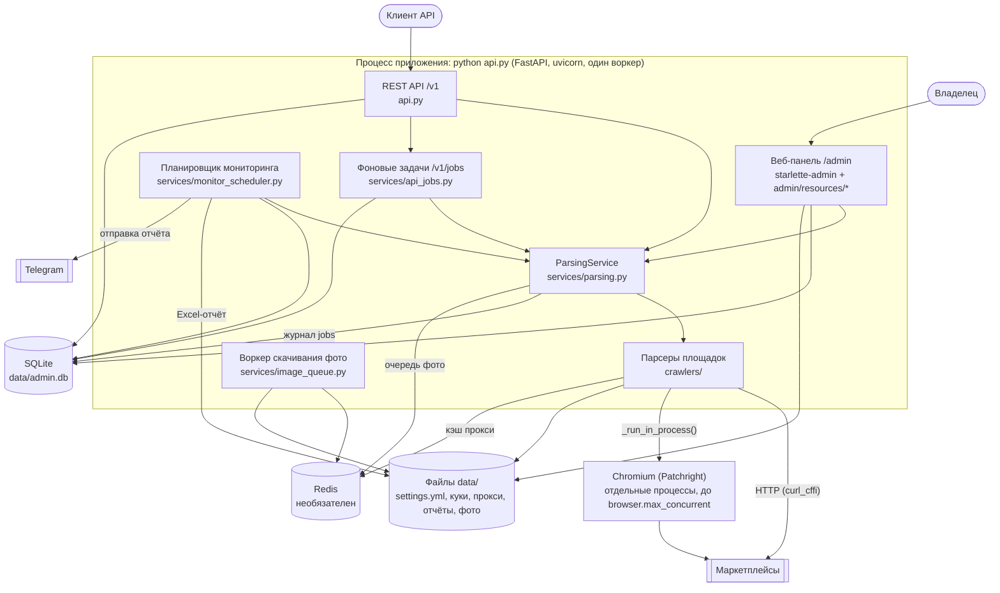

# C4, уровень 2: контейнеры

Из каких частей состоит установка и как они связаны. Всё приложение работает одним процессом Python (`python api.py`), браузеры запускаются отдельными процессами.

## За что отвечает каждая часть

| Часть | Где в коде | Ответственность |
|---|---|---|
| REST API | `api.py` | Публичные маршруты `/v1/*`, проверка `X-API-Key`. Старые пути без `/v1` работают как устаревшие |
| Веб-панель | `admin/__init__.py`, `admin/resources/*.py`, `admin/templates/` | Страницы starlette-admin и JSON-маршруты `/admin/*` под сессией администратора |
| ParsingService | `services/parsing.py` | Выбор парсера по URL, нормализация ссылки, пакетный разбор с ограничением параллельности, журнал `jobs`, постановка фото в очередь |
| Парсеры | `crawlers/` | Разбор карточки и сбор ссылок на одной площадке, см. [компоненты](c4-components.md) |
| Планировщик мониторинга | `services/monitor_scheduler.py`, `services/monitoring.py`, `services/reporting.py` | Перепроверка целей по расписанию, история цен, изменения цены, Excel-отчёт и его отправка в Telegram |
| Задачи /v1/jobs | `services/api_jobs.py` | Фоновый разбор до 1000 ссылок с сохранением каждого результата |
| Воркер фото | `services/image_queue.py`, `services/image_downloader.py` | Скачивание фотографий товаров из очереди Redis |
| Chromium | `crawlers/base.py` `_run_in_process()` | Страницы, которые не отдаются обычным HTTP: антиботы, капча, куки (ADR 0009) |
| SQLite | `models/` | Цели, товары, история цен, ключи и задачи API, см. [ERD](erd.md) |
| Redis | `services/redis_client.py` | Очередь фото, кэш прокси, счётчики. Без него приложение работает, но фото не скачиваются |

## Что запускается при старте

`lifespan()` в `api.py`: подключение к Redis и воркер фото → `setup_admin()` (база, импорт ключа из настроек, маршруты панели) → планировщик мониторинга → сброс «зависших» сессий парсинга и задач API, оставшихся от прошлого запуска.
