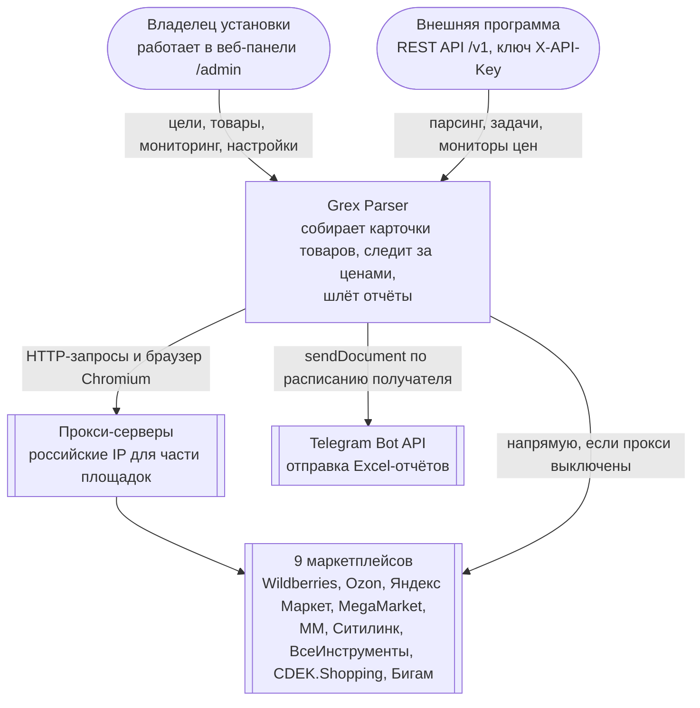

# C4, уровень 1: контекст системы

Кто пользуется Grex Parser и с какими внешними системами он работает.

## Границы

- **Внутри системы:** всё, что запускается из этого репозитория: сервер FastAPI, фоновые задачи, база SQLite, браузеры для парсинга.
- **Снаружи:** маркетплейсы (их API и страницы меняются без предупреждения), прокси (их выдаёт владелец установки), Telegram, клиенты API.
- **Redis** на этом уровне считается частью установки, а не внешней системой: он необязателен и ставится рядом (см. [контейнеры](c4-container.md)).
