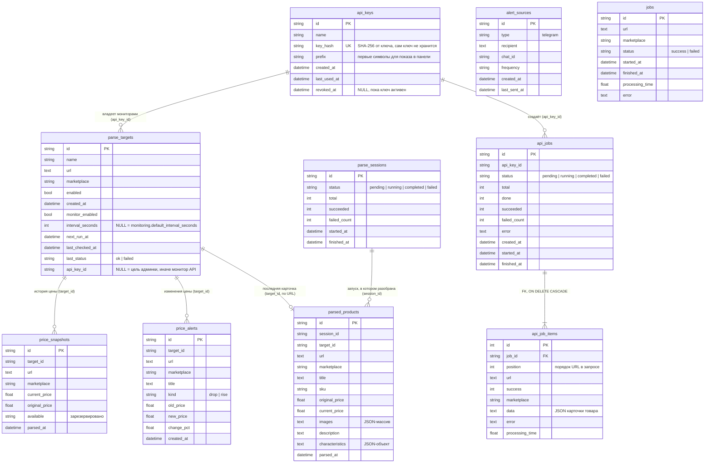

# Модель данных (ERD)

База: SQLite, файл `data/admin.db` (путь задаёт `admin.db_url` в `data/settings.yml`). Таблицы описаны моделями SQLAlchemy в `models/` и создаются при старте в `init_db()` (`models/job.py`).

Внешний ключ в базе объявлен только один: `api_job_items.job_id` → `api_jobs.id` (с `ON DELETE CASCADE`). Остальные связи на схеме логические: колонка хранит `id` другой таблицы, но база это не проверяет. Целостность держит код. Например, при удалении API-ключа его мониторы, история цен и задачи удаляются явно в `admin/resources/api_keys.py`.

## Что важно знать о связях

- **Владелец цели.** `parse_targets.api_key_id` = NULL означает цель админ-панели, непустое значение — монитор публичного API (`/v1/monitors`). Админка и отчёты показывают только свои цели через фильтры `admin_owned()` и `not_api_owned()` из `models/parse_target.py`. Любой новый запрос к целям, истории цен или оповещениям должен использовать эти фильтры.
- **История цен админки связана ещё и по URL.** Для целей админки предыдущая цена ищется по `price_snapshots.url` (так удалённая и заново добавленная цель продолжает свой график), для мониторов API — только по `target_id` (`_previous_price` в `services/monitoring.py`).
- **`parsed_products`** хранит одну строку на URL для раздела «Товары»: при повторном разборе строка с тем же `url` перезаписывается (`_upsert_parsed_product` в `admin/resources/targets.py`), а `session_id` указывает на последний запуск. Мониторы API туда не пишут, их цены лежат только в `price_snapshots`.
- **`jobs`** — журнал каждого вызова парсера (раздел «История задач»), пишется в `ParsingService._save_job`. С другими таблицами не связан.
- **`alert_sources`** — куда отправлять оповещения и отчёты (Telegram), с таблицами целей не связан.

## Как меняется схема

Миграций (Alembic) нет. `Base.metadata.create_all()` создаёт недостающие таблицы, но не меняет существующие. Новая колонка в уже существующей таблице добавляется так:

1. Колонка объявляется в модели.
2. Та же колонка с SQL-типом добавляется в `_ADDED_COLUMNS` в `models/job.py`. При старте `_migrate_added_columns()` выполнит `ALTER TABLE … ADD COLUMN` для отсутствующих колонок.

Так можно только добавлять колонки. Переименование, удаление колонки или смена типа требуют отдельного решения (ADR) и ручного переноса данных. Почему так, описано в [ADR 0001](../adr/0001-sqlite-without-migrations.md).

## Что хранится вне SQLite

| Где | Что |
|---|---|
| Redis `proxy:pool` | кэш списка прокси (TTL 60 с) |
| Redis `grex:image_queue` | очередь скачивания фотографий товаров |
| Redis `stats:*` | счётчики парсинга |
| `data/settings.yml` | настройки, логин и пароль панели, `secret_key` |
| `data/proxy.txt`, `data/proxies.json` | прокси |
| `data/*_cookies.json` | куки маркетплейсов |
| `data/wb_upstreams.json` | карта CDN-хостов Wildberries |
| `data/wb_api_session.json` | антибот-токен Wildberries и заголовки браузера |
| `data/reports/` | Excel-отчёты мониторинга |
