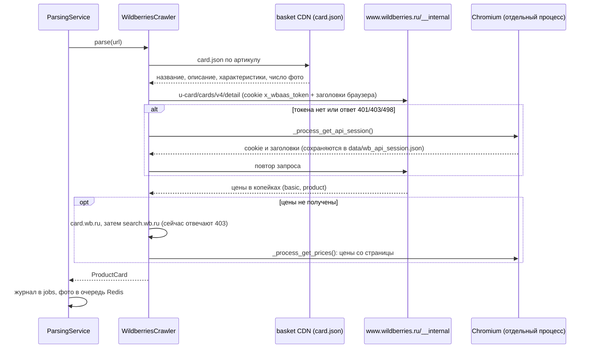
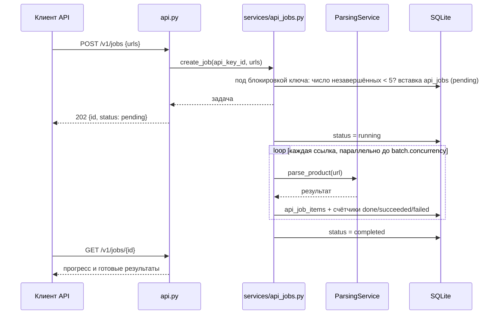
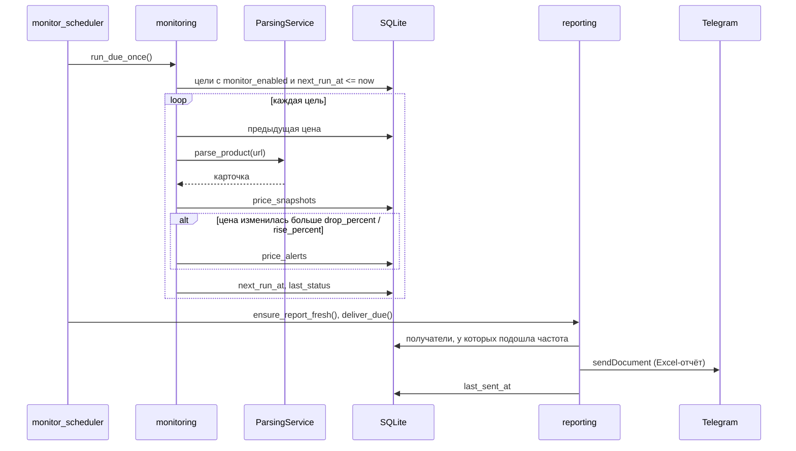

# Сценарии

Как части системы взаимодействуют во времени в процессах, которые трудно понять по коду.

## Разбор товара Wildberries

Цепочка запасных путей в `WildberriesCrawler.parse()` (`crawlers/wildberries.py`). Внутренний API и токен описаны в ADR 0004.

## Фоновая задача /v1/jobs

`services/api_jobs.py`. Состояния задачи: [диаграмма](states.md#задача-api-api_jobsstatus).

- Если сервер перезапустился во время задачи, при старте `reset_stale_jobs()` помечает её `failed`.
- Отзыв ключа отменяет его задачи, они получают `failed` с ошибкой «API key revoked» (PR #46).

## Проверка монитора и изменение цены

`services/monitoring.py`, см. [компоненты мониторинга](c4-components.md#мониторинг-services).

