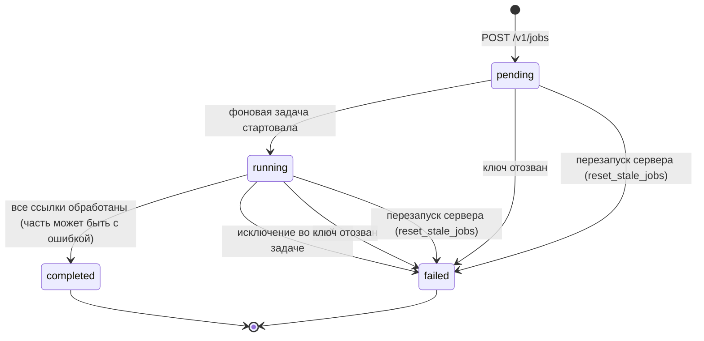
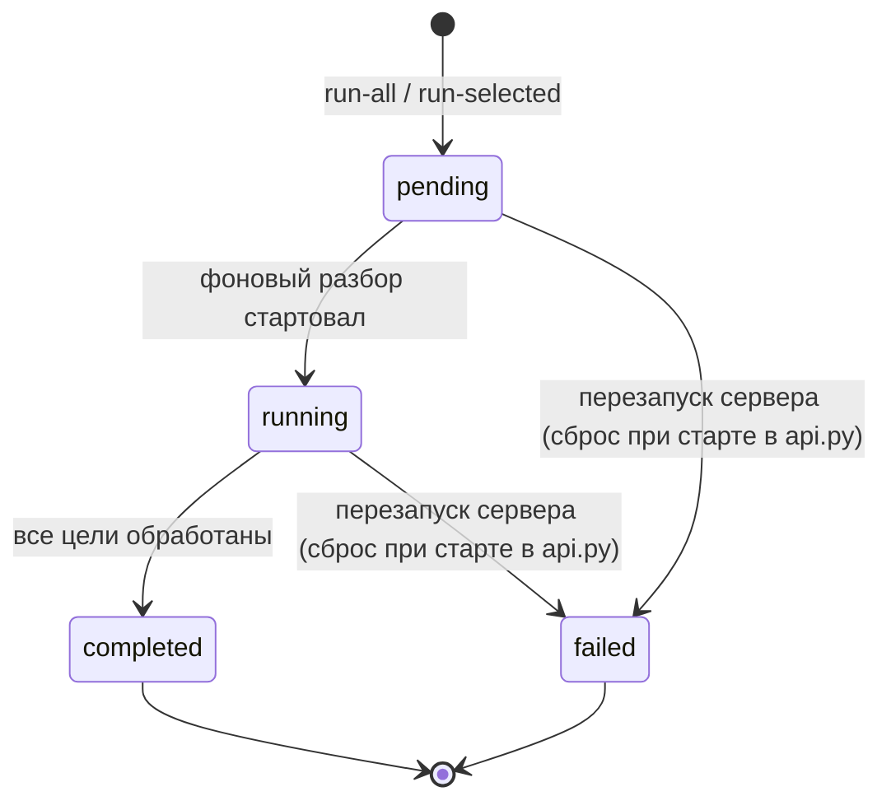

# Состояния

## Задача API (`api_jobs.status`)

`services/api_jobs.py`.

- Ошибка отдельной ссылки не переводит задачу в `failed`: она видна в `results` со `success: false`, а задача завершается как `completed`.
- Пока у ключа 5 задач в `pending` или `running`, новая получает `429`.

## Запуск парсинга из панели (`parse_sessions.status`)

`admin/resources/targets.py`: «Запустить все» и «Запустить выбранные».

