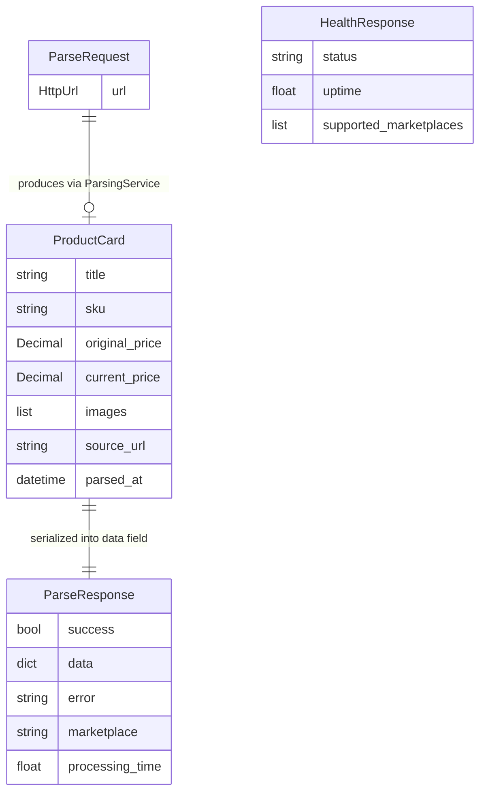

# Data Model

> Purpose: This file documents all data structures used by the application — Pydantic models, dataclasses, file-based state, and configuration schemas. Persistent state lives in a SQLite database (tables and relations: `docs/architecture/erd.md`), in files under `data/` and in Redis.
> Context: Read this file before modifying any model class, serialization logic, file-based state, or configuration structure.
> Version: 1.1

## 1. Core principle

The data model is the source of truth for all information exchanged between layers.

- Every model field must be documented
- Every file-based state location must be listed
- Every configuration key must be explained
- Implicit or undocumented fields are forbidden
- Model changes must be reflected here before implementation

## 2. Application data flow

## 3. Model documentation

### `ProductCard` (dataclass — `models/product.py`)

The core output of every crawler. Represents a parsed marketplace product.

| Field | Type | Nullable | Description |
|---|---|---|---|
| `title` | `str` | Yes (may be `None` on parse failure) | Product display name as scraped |
| `sku` | `str` | Yes | Marketplace-specific product identifier extracted from URL or response |
| `original_price` | `Decimal` | No (defaults to `0.0`) | Pre-discount price in local currency (RUB). WB returns price in kopecks divided by 100 |
| `current_price` | `Decimal` | No (defaults to `0.0`) | Current selling price in local currency (RUB) |
| `images` | `List[str]` | No (defaults to `[]`) | Ordered list of image URLs. WB images are `.webp`. YM images sorted by resolution descending |
| `source_url` | `str` | No | Original request URL passed to the crawler |
| `parsed_at` | `datetime` | No | Timestamp of when parsing was performed (auto-set) |

**Serialization method:** `to_dict()` — converts `Decimal` prices to `float`, excludes `parsed_at`.

---

### `ParseRequest` (Pydantic model — `models/product.py`)

Input validation for `POST /parse`.

| Field | Type | Nullable | Validation |
|---|---|---|---|
| `url` | `HttpUrl` | No | Must contain a supported marketplace domain (validated by `validate_marketplace_url`) |

**Supported domains validated at request time:**
- `wildberries.ru`, `wildberries.by`, `wildberries.kz`
- `ozon.ru`, `ozon.by`, `ozon.kz`
- `market.yandex.ru`, `market.yandex.by`
- `megamarket.ru`

---

### `ParseResponse` (Pydantic model — `models/product.py`)

Unified API response for `POST /parse`.

| Field | Type | Nullable | Description |
|---|---|---|---|
| `success` | `bool` | No | `true` if parsing completed without exception |
| `data` | `Dict[str, Any]` | Yes | Populated with `ProductCard.to_dict()` on success; `None` on failure |
| `error` | `str` | Yes | Human-readable error message on failure; `None` on success |
| `marketplace` | `str` | Yes | Detected marketplace name (e.g. `"wildberries"`, `"ozon"`); `None` on detection failure |
| `processing_time` | `float` | Yes | Total request duration in seconds |

---

### `HealthResponse` (Pydantic model — `models/product.py`)

Response for `GET /health`.

| Field | Type | Description |
|---|---|---|
| `status` | `str` | Always `"healthy"` while process is running |
| `uptime` | `float` | Seconds since `ParsingService` was instantiated |
| `supported_marketplaces` | `List[str]` | List of registered marketplace keys from `CrawlerFactory` |

## 4. Persistent state

### 4.1 SQLite database

`data/admin.db` (path from `admin.db_url`), SQLAlchemy models in `models/`, tables created on startup by `init_db()` in `models/job.py`. The ERD with all columns and relations is in `docs/architecture/erd.md` — it is the reference for the tables below.

| Table | Model | Purpose | Written by |
|---|---|---|---|
| `parse_targets` | `ParseTarget` (`models/parse_target.py`) | Links to parse; monitoring schedule. `api_key_id` NULL = admin panel target, set = public API monitor | `admin/resources/targets.py`, `admin/resources/monitors.py`, `services/api_monitors.py`, `services/monitoring.py` |
| `parsed_products` | `ParsedProduct` (`models/parsed_product.py`) | Latest product card per URL (upsert by `url`) for the «Товары» section | `admin/resources/targets.py` (`_upsert_parsed_product`), `services/monitoring.py` |
| `parse_sessions` | `ParseSession` (`models/parsed_product.py`) | Progress of a bulk run from the admin panel | `admin/resources/targets.py` |
| `price_snapshots` | `PriceSnapshot` (`models/price_snapshot.py`) | Price history of monitored targets | `services/monitoring.py` |
| `price_alerts` | `PriceAlert` (`models/price_snapshot.py`) | Price changes beyond `monitoring.drop_percent` / `rise_percent` | `services/monitoring.py` |
| `alert_sources` | `AlertSource` (`models/alert_source.py`) | Telegram recipients of alerts and reports | `admin/resources/alert_sources.py` |
| `jobs` | `Job` (`models/job.py`) | Log of every parser call («История задач») | `ParsingService._save_job` (`services/parsing.py`) |
| `api_keys` | `ApiKey` (`models/api_key.py`) | Public API keys, SHA-256 hash only | `services/api_keys.py`, `admin/resources/api_keys.py` |
| `api_jobs` | `ApiJob` (`models/api_job.py`) | Background parse jobs of `/v1/jobs` | `services/api_jobs.py` |
| `api_job_items` | `ApiJobItem` (`models/api_job.py`) | One finished URL of an API job | `services/api_jobs.py` |

Rules:

- Only one foreign key exists in the database: `api_job_items.job_id` → `api_jobs.id` (`ON DELETE CASCADE`). Every other relation is logical — code keeps it consistent and deletes dependent rows explicitly
- Queries over targets, price snapshots or alerts in the admin panel and reports must use `admin_owned()` / `not_api_owned()` from `models/parse_target.py`, so API monitors never show up there
- Timestamps are naive UTC (`datetime.utcnow()`)
- There are no migrations. `create_all()` creates missing tables only; a column added to an existing table must also be listed in `_ADDED_COLUMNS` in `models/job.py`, which runs `ALTER TABLE … ADD COLUMN` on startup. Renaming, dropping or retyping a column needs an ADR and a manual data migration

### 4.2 Files in `data/`

| File | Owner | Format | Purpose |
|---|---|---|---|
| `data/settings.yml` | `config.py` | YAML | Application configuration loaded at startup; created from `data/settings.yml.example` by `start.sh` |
| `data/proxy.txt` | `ProxyManager` | Plain text | One proxy per line in `user:pass@host:port` format |
| `data/proxies.json` | `admin/resources/proxies.py` | JSON list | Proxy pool edited in the admin panel (backup when Redis is down) |
| `data/ozon_cookies.json`, `data/ozon_api_headers.json` | `OzonCrawler` | JSON | Session cookies and API headers for Ozon, obtained via the browser |
| `data/mega_market_cookies.json` | `MegaMarketCrawler` | JSON dict | Session cookies for MegaMarket, obtained via the browser |
| `data/ym_cookies.json`, `data/ym_browser_profile/` | `YandexMarketCrawler` | JSON / browser profile | Yandex Market session (captcha solved manually once) |
| `data/citilink_cookies.json` | `CitilinkCrawler` | JSON dict | Session cookies for Citilink |
| `data/wb_upstreams.json` | `WildberriesCrawler` | JSON | CDN upstream routing map fetched from `cdn.wbbasket.ru` |
| `data/reports/` | `services/reporting.py` | XLSX | Monitoring reports |

### 4.3 Redis

| Key | Owner | Purpose |
|---|---|---|
| `proxy:pool` | `core/managers.py` | Cached proxy list (TTL 60 s) |
| `grex:image_queue` | `services/image_queue.py` | Queue of product images to download |
| `stats:*` | `services/stats.py` | Parsing counters |

Redis is optional: without it the app runs, but product images are not downloaded.

## 5. Configuration schema (`data/settings.yml`)

| Key path | Type | Default | Description |
|---|---|---|---|
| `app.host` | `str` | `"localhost"` | uvicorn bind host |
| `app.port` | `int` | `8004` | uvicorn bind port |
| `security.api_key` | `str` | `""` | Optional legacy key, imported once into the `api_keys` table on startup when non-empty; keys are created and managed in the admin panel |
| `max_retries` | `int` | `3` | Number of retry attempts per crawler on failure |
| `proxy.active` | `bool` | `false` | Enables proxy rotation for crawlers that support it |
| `proxy.type` | `str` | `"http"` | Proxy protocol: `"http"` or `"socks5"` |
| `debug.active` | `bool` | `false` | Enables Swagger UI at `/docs`, `/redoc`; sets log level to DEBUG |
| `debug.logging_in_file` | `bool` | `false` | Enables file-based log rotation in `logs/YYYY-MM-DD.log` |
| `soft_version` | `str` | contents of `VERSION` | Read from the `VERSION` file in the repo root by `config.py`; not in YAML |
| `is_demo` | `bool` | — | Optional flag; replaces log context label with `"DEMO MODE"` |

## 6. Change management rules

When modifying any model or file-based state:

1. Update this document first — and `docs/architecture/erd.md` for any table or column change
2. Update the relevant model class
3. Update any `to_dict()` or serialization methods
4. Update API response documentation in `rules/api/endpoints.md`
5. Write or update tests

Never change a model field without updating this file.

## 7. Definition of done

A data model change is not complete until:

- This schema document is updated
- All affected model fields are documented
- File-based state changes are noted
- `to_dict()` output is verified
- Tests cover the changed fields

## Forbidden behaviors

- ❌ Undocumented model fields
- ❌ Fields accessed in crawlers that are not listed here
- ❌ Hardcoded file paths outside `data/` directory
- ❌ Adding fields to `ProductCard.to_dict()` without documenting them
- ❌ Configuration keys accessed via `settings.get()` that are not in this schema

## Checklist

- [ ] All Pydantic models documented
- [ ] All dataclass fields documented
- [ ] SQLite tables match `docs/architecture/erd.md` and section 4.1
- [ ] New columns of existing tables are listed in `_ADDED_COLUMNS`
- [ ] File-based state inventory complete
- [ ] Configuration schema complete
- [ ] `to_dict()` output fields listed
- [ ] No undocumented fields or files
