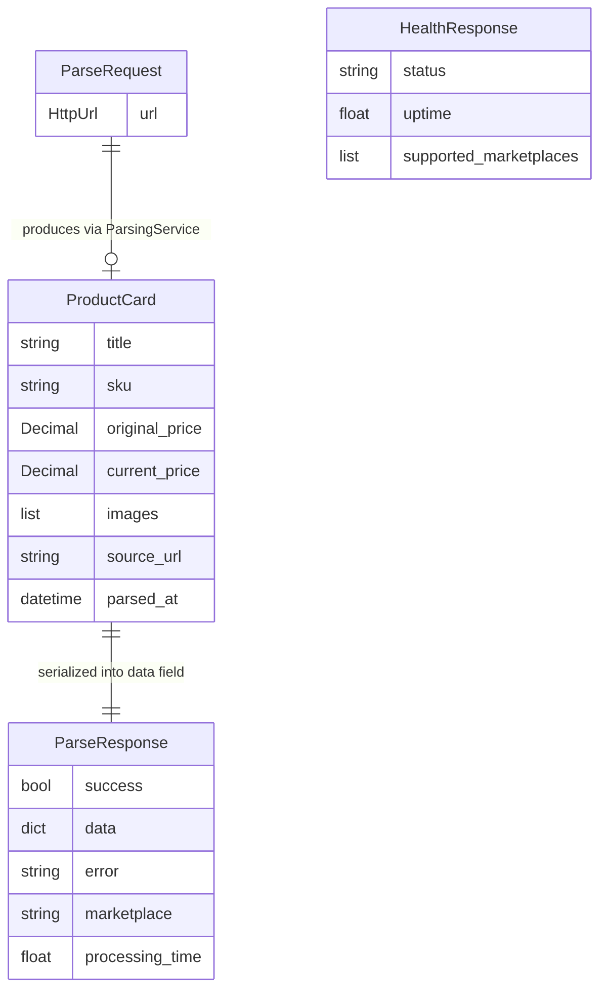

# Data Model

> Purpose: This file documents all data structures used by the application — Pydantic models, dataclasses, file-based state, and configuration schemas. There is no relational SQL database in this project; persistence is file-based (JSON cookies files, JSON upstreams cache, YAML configuration, text proxy list).
> Context: Read this file before modifying any model class, serialization logic, file-based state, or configuration structure.
> Version: 1.0

## 1. Core principle

The data model is the source of truth for all information exchanged between layers.

- Every model field must be documented
- Every file-based state location must be listed
- Every configuration key must be explained
- Implicit or undocumented fields are forbidden
- Model changes must be reflected here before implementation

## 2. Application data flow

## 3. Model documentation

### `ProductCard` (dataclass — `models/product.py`)

The core output of every crawler. Represents a parsed marketplace product.

| Field | Type | Nullable | Description |
|---|---|---|---|
| `title` | `str` | Yes (may be `None` on parse failure) | Product display name as scraped |
| `sku` | `str` | Yes | Marketplace-specific product identifier extracted from URL or response |
| `original_price` | `Decimal` | No (defaults to `0.0`) | Pre-discount price in local currency (RUB). WB returns price in kopecks divided by 100 |
| `current_price` | `Decimal` | No (defaults to `0.0`) | Current selling price in local currency (RUB) |
| `images` | `List[str]` | No (defaults to `[]`) | Ordered list of image URLs. WB images are `.webp`. YM images sorted by resolution descending |
| `source_url` | `str` | No | Original request URL passed to the crawler |
| `parsed_at` | `datetime` | No | Timestamp of when parsing was performed (auto-set) |

**Serialization method:** `to_dict()` — converts `Decimal` prices to `float`, excludes `parsed_at`.

---

### `ParseRequest` (Pydantic model — `models/product.py`)

Input validation for `POST /parse`.

| Field | Type | Nullable | Validation |
|---|---|---|---|
| `url` | `HttpUrl` | No | Must contain a supported marketplace domain (validated by `validate_marketplace_url`) |

**Supported domains validated at request time:**
- `wildberries.ru`, `wildberries.by`, `wildberries.kz`
- `ozon.ru`, `ozon.by`, `ozon.kz`
- `market.yandex.ru`, `market.yandex.by`
- `megamarket.ru`

---

### `ParseResponse` (Pydantic model — `models/product.py`)

Unified API response for `POST /parse`.

| Field | Type | Nullable | Description |
|---|---|---|---|
| `success` | `bool` | No | `true` if parsing completed without exception |
| `data` | `Dict[str, Any]` | Yes | Populated with `ProductCard.to_dict()` on success; `None` on failure |
| `error` | `str` | Yes | Human-readable error message on failure; `None` on success |
| `marketplace` | `str` | Yes | Detected marketplace name (e.g. `"wildberries"`, `"ozon"`); `None` on detection failure |
| `processing_time` | `float` | Yes | Total request duration in seconds |

---

### `HealthResponse` (Pydantic model — `models/product.py`)

Response for `GET /health`.

| Field | Type | Description |
|---|---|---|
| `status` | `str` | Always `"healthy"` while process is running |
| `uptime` | `float` | Seconds since `ParsingService` was instantiated |
| `supported_marketplaces` | `List[str]` | List of registered marketplace keys from `CrawlerFactory` |

## 4. File-based state inventory

The application has no SQL database. Persistence is maintained through files in the `data/` directory.

| File | Owner | Format | Purpose |
|---|---|---|---|
| `data/settings.yml` | `config.py` | YAML | Application configuration loaded at startup |
| `data/proxy.txt` | `ProxyManager` | Plain text | One proxy per line in `user:pass@host:port` format |
| `data/ozon_cookies.json` | `OzonCrawler` | JSON dict | Session cookies for Ozon, obtained via Playwright browser |
| `data/mega_market_cookies.json` | `MegaMarketCrawler` | JSON dict | Session cookies for MegaMarket, obtained via Playwright browser |
| `data/wb_upstreams.json` | `WildberriesCrawler` | JSON | CDN upstream routing map fetched from `cdn.wbbasket.ru` |

## 5. Configuration schema (`data/settings.yml`)

| Key path | Type | Default | Description |
|---|---|---|---|
| `app.host` | `str` | `"localhost"` | uvicorn bind host |
| `app.port` | `int` | `8004` | uvicorn bind port |
| `security.api_key` | `str` | `""` | Optional legacy key, imported once into the `api_keys` table on startup when non-empty; keys are created and managed in the admin panel |
| `max_retries` | `int` | `3` | Number of retry attempts per crawler on failure |
| `proxy.active` | `bool` | `false` | Enables proxy rotation for crawlers that support it |
| `proxy.type` | `str` | `"http"` | Proxy protocol: `"http"` or `"socks5"` |
| `debug.active` | `bool` | `false` | Enables Swagger UI at `/docs`, `/redoc`; sets log level to DEBUG |
| `debug.logging_in_file` | `bool` | `false` | Enables file-based log rotation in `logs/YYYY-MM-DD.log` |
| `soft_version` | `str` | contents of `VERSION` | Read from the `VERSION` file in the repo root by `config.py`; not in YAML |
| `is_demo` | `bool` | — | Optional flag; replaces log context label with `"DEMO MODE"` |

## 6. Change management rules

When modifying any model or file-based state:

1. Update this document first
2. Update the relevant model class
3. Update any `to_dict()` or serialization methods
4. Update API response documentation in `rules/api/endpoints.md`
5. Write or update tests

Never change a model field without updating this file.

## 7. Definition of done

A data model change is not complete until:

- This schema document is updated
- All affected model fields are documented
- File-based state changes are noted
- `to_dict()` output is verified
- Tests cover the changed fields

## Forbidden behaviors

- ❌ Undocumented model fields
- ❌ Fields accessed in crawlers that are not listed here
- ❌ Hardcoded file paths outside `data/` directory
- ❌ Adding fields to `ProductCard.to_dict()` without documenting them
- ❌ Configuration keys accessed via `settings.get()` that are not in this schema

## Checklist

- [ ] All Pydantic models documented
- [ ] All dataclass fields documented
- [ ] File-based state inventory complete
- [ ] Configuration schema complete
- [ ] `to_dict()` output fields listed
- [ ] No undocumented fields or files
