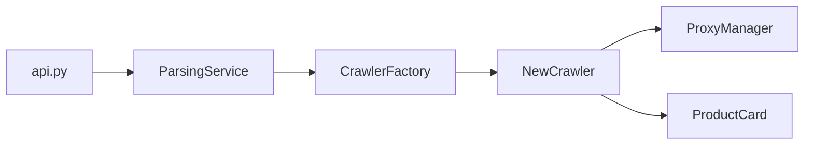
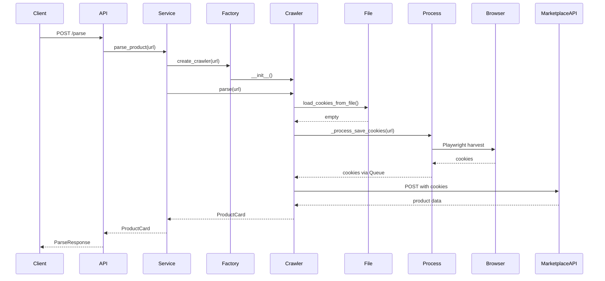

# Architecture Design Rules

> Purpose: Ensure every change starts with explicit design. Force the agent to think structurally before generating code.
> Context: Read this file before implementing any feature, refactor, model change, or new crawler.
> Version: 1.0

## 1. Core principle

Design first. Code second.
- Never start with implementation
- Always define structure before details
- Always document boundaries
- Always minimize complexity

If design is missing — stop and design.

## 2. Current architecture overview

This project follows a layered architecture with a clear flow:

```
HTTP Request
     |
     v
api.py (FastAPI endpoint handlers)
     |
     v
services/parsing.py (ParsingService — orchestration only)
     |
     v
core/factory.py (CrawlerFactory — URL detection + crawler instantiation)
     |
     v
crawlers/*.py (Marketplace-specific crawlers extending BaseCrawler)
     |
     v
core/managers.py (ProxyManager — shared infrastructure)
     |
     v
models/product.py (ProductCard, ParseRequest, ParseResponse, HealthResponse)
```

**Layer responsibilities:**
- `api.py` — HTTP transport only: authentication, request validation via Pydantic, response serialization, middleware, exception handling
- `services/parsing.py` — Orchestration: creates crawlers via factory, translates exceptions to HTTP errors
- `core/factory.py` — Factory: marketplace detection by URL regex, crawler class instantiation
- `crawlers/*.py` — Marketplace logic: HTTP requests, browser automation, cookie management, retry logic, data extraction
- `core/managers.py` — Shared infrastructure: proxy loading, validation, random selection
- `models/product.py` — Data contracts: all Pydantic and dataclass definitions

## 3. Mandatory pre-implementation steps

**Step 1 — Read context**
- Read `rules/README.md`
- Read all relevant domain files in `rules/domain/`
- Read `rules/database/schema.md`
- Read related source files
- Identify existing patterns to reuse

**Step 2 — Define the problem**
- State the goal in 1–3 sentences
- List non-goals explicitly
- Define success criteria
- Identify constraints (marketplace bot detection, async/sync Playwright boundary, cookie expiry)

**Step 3 — Propose a design**

Must include:
- Affected layers
- New/modified modules
- Public contracts (method signatures, return types)
- Data model changes (if any)
- Risks and trade-offs

Do not write implementation yet.

**Step 4 — Validate the design**
- Check that new crawlers follow `BaseCrawler` contract
- Check that new endpoints follow the `ParseResponse`/`ParseRequest` contract
- Check for duplication with existing crawlers
- Prefer extending existing patterns over introducing new abstractions

Only after validation — implementation is allowed.

## 4. Required design artifacts

**For a new crawler:** Class diagram showing inheritance from `BaseCrawler`, data flow from URL to `ProductCard`, cookie lifecycle (if applicable), retry loop design

**For a new API endpoint:** Request/response schema, authentication requirement, side effects, error cases

**For a model change:** Before/after field listing, `to_dict()` output change, backward compatibility analysis

**For a new infrastructure component:** Layer impact analysis, concurrency safety (async vs sync, multiprocessing boundary)

## 5. Layer boundary rules

```python
# ✅ Correct — api.py delegates entirely to service
@app.post("/parse", response_model=ParseResponse)
async def parse_product(request: ParseRequest):
    product_card = await parsing_service.parse_product(url=str(request.url))
    return ParseResponse(success=True, data=product_card.to_dict(), ...)

# ❌ Incorrect — business logic inside endpoint handler
@app.post("/parse", response_model=ParseResponse)
async def parse_product(request: ParseRequest):
    if "wildberries" in str(request.url):
        # Direct crawling logic in handler — violates layer boundary
        response = await session.get(...)
```

```python
# ✅ Correct — crawler only extracts data, does not handle HTTP errors
async def parse(self, url: str) -> ProductCard:
    raise ProductCardParsingException("SKU not found")

# ❌ Incorrect — crawler raises HTTPException (framework concern)
async def parse(self, url: str) -> ProductCard:
    raise HTTPException(status_code=400, detail="SKU not found")
```

## 6. Async/sync boundary rules

This project uses `asyncio` (FastAPI + uvicorn). Playwright's `sync_playwright` must never be called from within the async event loop.

```python
# ✅ Correct — Playwright runs in a separate multiprocessing.Process
process = Process(target=self._process_save_cookies, args=(...))
process.start()
while process.is_alive():
    await asyncio.sleep(0.1)

# ❌ Incorrect — blocks the event loop
with sync_playwright() as p:
    browser = p.chromium.launch(...)
```

## 7. Complexity control rules

- Prefer modifying existing crawlers over creating new abstractions
- Avoid subclassing beyond `BaseCrawler` unless a clear shared behavior exists
- Do not add new framework dependencies without a clear reason
- Rule of thumb: if a new crawler needs more than 2 new files, reconsider the design

## 8. Diagram requirements

**Component diagram (new crawler):**


**Sequence diagram (cookie harvest flow):**


## 9. Forbidden behaviors

- ❌ Coding before design
- ❌ Adding `HTTPException` raises inside crawlers (belongs in `services/parsing.py`)
- ❌ Calling `sync_playwright()` directly in any async context
- ❌ Adding middleware without documenting behavior in `rules/api/endpoints.md`
- ❌ Introducing new config keys without documenting in `rules/database/schema.md`
- ❌ Mixing proxy logic into crawlers without going through `ProxyManager`

## 10. Definition of ready

Implementation may start only if:
- Problem is defined
- Scope is bounded
- Design exists
- Layer boundaries are respected
- Async/sync boundary is safe
- Impacted files are listed
- Risks identified

If any item is missing — design is incomplete.

## Checklist

- [ ] Context files read
- [ ] Problem defined in 1–3 sentences
- [ ] Design proposed
- [ ] Diagrams created if feature is non-trivial
- [ ] Layer boundaries respected
- [ ] Async/sync boundary safe
- [ ] Complexity minimized
- [ ] No new abstractions introduced without justification
- [ ] Small incremental implementation plan prepared
